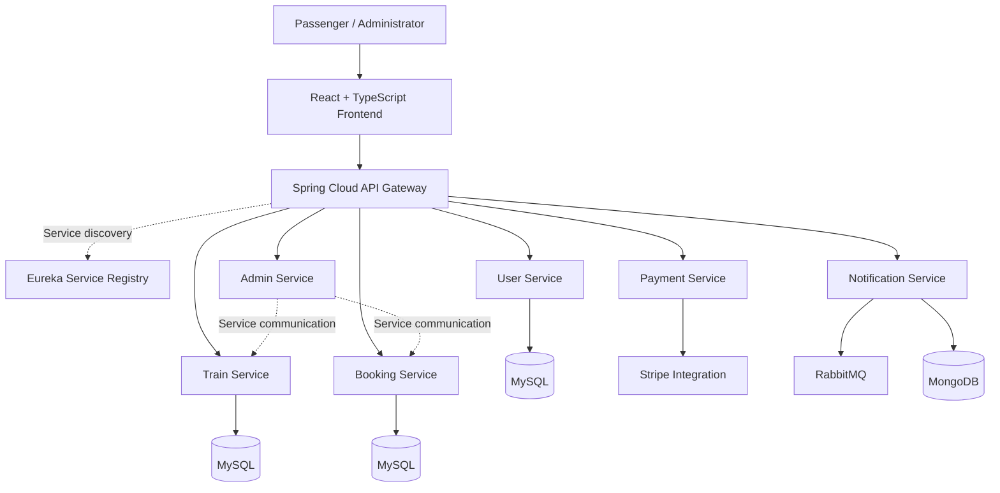

# RailConnect — Railway Reservation System

A full-stack railway reservation platform built with **React, TypeScript, Java, and Spring Boot microservices**. RailConnect separates core railway operations into independently organized services for train management, user management, booking, payments, notifications, and administration.

**Repository:** [Shikhar-13/RailConnect](https://github.com/Shikhar-13/RailConnect)

## Overview

RailConnect is a railway booking system designed to demonstrate full-stack development and distributed backend architecture. The application combines a web-based user interface with independently deployable backend services, centralized API routing, and service discovery.

The project explores how domain-based service separation can improve maintainability, isolate responsibilities, and allow individual components to evolve independently.

## Architecture



*The diagram represents the high-level service organization and integrations identified in the repository. Exact runtime routes, database ownership, and message flows should be verified against the service configuration and implementation.*

## Core Components

| Component | Responsibility |
|---|---|
| Frontend | React and TypeScript interface for interacting with the application |
| API Gateway | Central entry point for routing frontend requests to backend services |
| Eureka Server | Service registration and discovery |
| User Service | User-related operations and persistence |
| Train Service | Train-domain operations and persistence |
| Booking Service | Reservation-related business logic and persistence |
| Payment Service | Payment integration using Stripe's Java SDK |
| Notification Service | Notification-related operations, RabbitMQ integration, and MongoDB support |
| Admin Service | Administrative operations |

## Technology Stack

### Frontend
- React 18
- TypeScript
- Vite
- Tailwind CSS
- Axios for HTTP requests
- React Router for client-side navigation
- TanStack Query and Zustand for data and client state management
- React Hook Form and Zod for form handling and validation
- Framer Motion for animations

### Backend
- Java 17
- Spring Boot
- Spring Web / WebMVC
- Spring Data JPA
- Spring Security
- Spring Cloud Netflix Eureka
- Spring Cloud Gateway
- OpenFeign for declarative service-to-service HTTP clients
- Lombok
- Maven

### Data and Integrations
- MySQL
- MongoDB
- RabbitMQ
- Stripe Java SDK
- JSON Web Token (JWT) libraries

## Repository Structure

```text
RailConnect/
├── Eureka-server/
│   └── Eureka-server/
├── api-gateway/
│   └── api-gateway/
├── userservice/
├── trainservice/
├── booking-service/
├── payment-service/
├── notification-service/
├── admin-service/
└── frontend/
```

Each backend service has its own Maven project, while the frontend is maintained as a separate Vite application.

## Getting Started

### Prerequisites

Install the following before running the application:

- JDK 17
- Maven
- Node.js and npm
- MySQL Server
- MongoDB, if using the notification service
- RabbitMQ, if using messaging functionality
- A Stripe test account and test credentials, if running payment flows

### 1. Clone the repository

```bash
git clone https://github.com/Shikhar-13/RailConnect.git
cd RailConnect
```

### 2. Configure the backend services

Review the configuration files in each service's `src/main/resources` directory.

Configure the appropriate values for:

- Server ports
- Database URLs, usernames, and passwords
- Eureka server address
- API Gateway routes
- JWT signing and validation settings, where applicable
- RabbitMQ connection settings
- MongoDB connection settings
- Stripe test credentials

Use environment variables or a local, untracked configuration file for secrets. Do not commit credentials or production keys.

### 3. Start the infrastructure

Start MySQL and any additional infrastructure required by the features you intend to test, such as MongoDB and RabbitMQ.

Create the required databases and verify the connection settings for each service before starting the backend.

### 4. Start the Eureka server

Navigate to the Eureka server's Maven project:

```bash
cd Eureka-server/Eureka-server
mvn spring-boot:run
```

Keep this process running. Confirm its configured port and registry URL from the application configuration.

### 5. Start the backend services

Open a separate terminal for each service. From the repository root, run the following commands individually:

```bash
cd userservice
mvn spring-boot:run
```

```bash
cd trainservice
mvn spring-boot:run
```

```bash
cd booking-service
mvn spring-boot:run
```

```bash
cd payment-service
mvn spring-boot:run
```

```bash
cd notification-service
mvn spring-boot:run
```

```bash
cd admin-service
mvn spring-boot:run
```

### 6. Start the API Gateway

```bash
cd api-gateway/api-gateway
mvn spring-boot:run
```

Ensure that the gateway routes match the backend service configuration and that the required services have registered with Eureka.

### 7. Start the frontend

Open another terminal:

```bash
cd frontend
npm install
npm run dev
```

Open the local URL printed by Vite in your terminal. Configure the frontend's API base URL to point to the running gateway if it is not already configured.

### Build and lint the frontend

```bash
npm run build
npm run lint
```

The build script runs TypeScript compilation before creating the production frontend bundle.

> **Note:** The commands above describe the individual project startup workflow. Exact ports, database names, environment variable names, service routes, and startup dependencies must be taken from the repository's configuration files.

## Engineering Considerations

### Service separation

Each service has its own Maven project and domain responsibility. This organization supports focused development and makes it easier to identify which component owns a particular business operation.

### API gateway and service discovery

The gateway provides a centralized entry point for frontend traffic. Eureka provides a registry that enables participating services to discover registered instances.

### Persistence

Spring Data JPA and the MySQL connector are included in the core transactional services. The notification service also includes MongoDB support, separating its persistence needs from the relational services.

### Payment integration

The payment service includes the Stripe Java SDK. Payment processing should be validated using test credentials and verified payment states before a booking is considered paid.

### Security

Spring Security and JWT-related dependencies are included in relevant backend services. Authentication, authorization, token validation, secret management, and endpoint-level access controls should be verified against the actual security configuration.

## Testing and Validation

Before considering the system ready for deployment, validate the following flows:

- [ ] Frontend can reach the API Gateway.
- [ ] Backend services register successfully with Eureka.
- [ ] Database connections and persistence operations work.
- [ ] User authentication and authorization behave as expected.
- [ ] Train queries return valid results.
- [ ] Booking operations validate inputs and reservation state.
- [ ] Payment success and failure scenarios are handled correctly.
- [ ] Notification delivery and message failure scenarios are handled correctly.
- [ ] Invalid requests return appropriate HTTP error responses.
- [ ] Frontend production build and lint checks pass.

These are validation targets, not a claim that every test has already passed.

## Future Improvements

Potential areas for further engineering work include:

- Transaction-safe seat allocation to prevent duplicate reservations under concurrent requests.
- Idempotent booking and payment operations to handle retries safely.
- Reliable event-driven communication between booking, payment, and notification services.
- Centralized logging, distributed tracing, and service health monitoring.
- Integration tests covering complete booking and payment workflows.
- Containerized local development using Docker Compose.
- CI/CD automation for reproducible builds and deployment.

## Disclaimer

RailConnect is an independent software project intended for learning and demonstration. It is not affiliated with or endorsed by Indian Railways or IRCTC. Live railway inventory, official ticket issuance, and real-world reservation availability should not be assumed unless supported by an authorized integration.

## Author

**Shikhar Gupta**

GitHub: [@Shikhar-13](https://github.com/Shikhar-13)

Project: [RailConnect](https://github.com/Shikhar-13/RailConnect)
